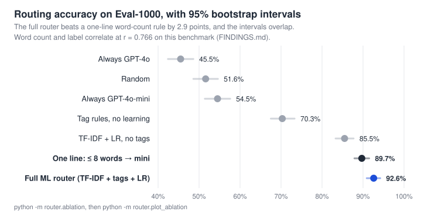

# Dual LLM System

## In 30 seconds
- **What it is:** A chatbot backend that sends each question to a small model running on your own machine (Gemma 4 E4B) or a paid cloud model (Gemini 3.8 Flash), and personalizes answers per user.
- **Why it matters:** Sending every query, even "hi", to the most expensive model wastes money.
- **Key result:** The router picks the right model 92.6% of the time on 1,000 labelled queries, but a one-line word-count rule reaches 89.7%; my ablation (removing parts to see what matters) traced most of the gain to query length, a quirk of the benchmark labels.
- **What I did:** Course project at Northeastern with Zichen Qi and Yalin Sun; the follow-up ablation (FINDINGS.md) and current paper are mine.
- **Built with:** Python, FastAPI, scikit-learn, SQLAlchemy (SQLite or Postgres), Next.js + TypeScript, Ollama (Gemma 4) + Gemini API, uv, Docker.
- **Try it:** `docker compose up --build` and open http://localhost:3000 (needs Ollama with `gemma4:e4b` and a Gemini API key; `uv run pytest -q` runs tests without either).

**A cascade router that sends each chat query to a small or a large model, plus an
honest ablation of why it works.** A word-count pre-flight, a TF-IDF + logistic
regression router, and a small-model classifier fallback pick the model; stored
user profiles and a sliding-window memory personalize the answer. The default pair is Gemma 4 E4B (local, via Ollama) and
Gemini 3.8 Flash; the original course project and the paper ran on GPT-4o-mini
and GPT-4o. The router's accuracy numbers are offline and don't depend on the
pair.

[](https://github.com/sandeepvijayarao09/dual-llm-system/actions/workflows/ci.yml)


[](LICENSE)



Built at Northeastern University as a course project with **Zichen Qi** and
**Yalin Sun**; their original report is in [`paper/archive/`](paper/archive/).
The follow-up ablation in [FINDINGS.md](FINDINGS.md) and the current paper in
[`paper/`](paper/) are by Sandeep Vijayarao.

---

## What it does

Most LLM apps send every query to the most expensive model, even `"hi"`. This
system routes each query through a 3-layer cascade: easy queries go to Gemma
4 E4B on your own machine (no per-token cost), hard ones to Gemini, and the
LLM classifier only runs when the offline router is unsure. It also keeps a
per-user profile and a bounded conversation memory, and only sends the profile
when the query needs it.

## Key numbers, and what they mean

All from the committed model on Eval-1000 (1,000 author-labelled queries, 23
categories). Reproduce with `python -m router.eval_1000` and
`python -m router.ablation`; the live cascade row needs Ollama:
`python -m router.live_cascade_eval --all`.

| Metric | Value | Read it as |
|---|---|---|
| ML router accuracy | **92.6%** (95% CI 90.9–94.2) | small vs big, against the labels |
| One-line baseline: `len(query.split()) <= 8` → small | **89.7%** (95% CI 87.9–91.5) | only 2.9 points behind; intervals overlap |
| Full cascade with a real classifier (Gemma 4 E4B) | **94.7%** (95% CI 93.2–96.0) | the fallback lifts the 147 deferred queries from 77.6% to 91.8%; see FINDINGS.md §8 |
| Queries the ML router decides alone | **85.3%** | the other 14.7% also get one small-model classifier call |
| Queries sent to the large model | **49.5%** | this drives serving cost; the labels say 45.5% need it |
| Estimated cost vs always-Gemini | **49.6%** | about $1.15 per 1,000 queries; word-count rule 46.9%, perfect routing 45.6%; see FINDINGS.md §7 |
| Seed training set | **239** examples | |

**What the ablation found** ([FINDINGS.md](FINDINGS.md)):

- The router's gain over plain TF-IDF (+7.1 points) comes almost entirely from
  the three **length** tags (+6.9). The thirteen semantic tags (reasoning
  keywords, code, math and so on) add +0.4 points, which is noise.
- The reason is the benchmark: word count and the `big` label correlate at
  **r = 0.766**, because one annotator wrote both the queries and the labels.
  The label flips almost deterministically at nine words.
- On the 103 queries where the word-count rule is wrong, the router is at
  chance (52.4%).

So the cascade works as engineering (it routes, falls back, logs and stays
cheap), but this benchmark cannot show that the semantic features matter. The
next step is a length-stratified eval set; see "Path B" in FINDINGS.md.

---

## Architecture

```
User Query
    │
    ▼
┌─────────────────────────────────────────────────────────┐
│  LAYER 0 — Pre-flight check                             │
│  query > 2000 words? → skip everything → Large LLM      │
└─────────────────────────────────────────────────────────┘
    │
    ▼
┌─────────────────────────────────────────────────────────┐
│  LAYER 1 — ML Router  (offline, ~0ms, no API call)      │
│  TF-IDF (1-3 grams, 5000 features)                      │
│  + 16 hand-crafted feature tags                         │
│  + Logistic Regression (balanced class weights)         │
│                                                         │
│  confidence ≥ 0.65 → use decision directly              │
│  confidence < 0.65 → cascade to Layer 2                 │
└─────────────────────────────────────────────────────────┘
    │ low confidence (~15% of queries)
    ▼
┌─────────────────────────────────────────────────────────┐
│  LAYER 2 — LLM Classifier  (Small LLM, JSON mode)       │
│  Returns: complexity, intent, confidence,               │
│           requires_tools, sensitive,                    │
│           routing_decision, profile_relevant            │
│                                                         │
│  confidence < 0.75 → force "big"                        │
│  parse failure     → default "big"                      │
└─────────────────────────────────────────────────────────┘
    │
    ├─── "small" ──────────────────────────────────────────►  Gemma 4 E4B (local)
    │    + profile context (if profile_relevant=true)          SimpleAnswerer
    │    + name stub (always, for greeting personalization)     ≤ 512 tokens
    │
    └─── "big" ────────────────────────────────────────────►  Gemini 3.8 Flash
         Step 1: Reasoner (core answer, audience hint)         ≤ 4096 tokens
         Step 2: Summarizer → 1-line summary (Small LLM)
         Step 3: Personalizer → intro + closing (Small LLM)
         Step 4: Assemble: intro + core + "---" + closing
```

### Services

```
Next.js UI (web/, :3000) ──/api──►  FastAPI (api/, :8000) ──►  Orchestrator (cascade above)
                                     POST /v1/chat/completions      │
                                     (chat-completions format)      ├─► provider adapters
                                                                    │   Ollama (Gemma 4) · Gemini API
                                                                    └─► SQLAlchemy: profiles, routing log
                                                                        (SQLite, or Postgres via DATABASE_URL)
```

Each model role is a provider plus a model (`SMALL_PROVIDER`/`SMALL_MODEL`,
`LARGE_PROVIDER`/`LARGE_MODEL`): any Ollama model or any Gemini API model,
including Gemma 4 31B (`gemma-4-31b-it`, free tier) for the large role. The
endpoint follows the OpenAI chat-completions format, so existing chat
clients can call the router as a model named `auto` (or `small`/`large` to
force one):

```bash
curl -s localhost:8000/v1/chat/completions -H 'content-type: application/json' \
  -d '{"model": "auto", "user": "cs_student", "messages": [{"role": "user", "content": "Hi!"}]}'
```

The response adds a `routing` object: decision, who decided, every LLM call
with tokens, latency and estimated cost, and the exact prompts sent. Interactive
API docs are at http://localhost:8000/docs.

---

## Feature Engineering (ML Router Tags)

The ML router encodes each query as a tag-augmented string before TF-IDF. On
Eval-1000 only the three `LEN_*` tags carry measurable signal; the rest add
+0.4 points combined, and `LEN_LONG`, `Q_MULTI` and `MULTI_SENTENCE` never fire
(FINDINGS.md section 2). They are kept because a less length-confounded
benchmark may need them.

```
encode_text("why is the sky blue?")
→ "LEN_SHORT HAS_REASONING_KW Q_SINGLE why is the sky blue?"
```

| Tag | Signal | Routing hint |
|---|---|---|
| `LEN_SHORT` | ≤ 8 words | → small |
| `LEN_MEDIUM` | 9–40 words | neutral |
| `LEN_LONG` | > 40 words | → big |
| `HAS_CODE` | `` ``` ``, `def `, `class `, `import ` | → big |
| `HAS_MATH` | digits+ops, `\int`, `\sum` | → big |
| `HAS_REASONING_KW` | why, how, compare, prove, explain, analyze… | → big |
| `HAS_FACTUAL_KW` | what is, who is, when did, define… | → small |
| `HAS_GREETING_KW` | hi, hello, thanks… | → small |
| `HAS_CREATIVE_KW` | joke, poem, story, haiku, pun… | → small |
| `HAS_OPINION_KW` | best, vs, should I, pros and cons… | → big |
| `HAS_DEEP_WHAT` | "what is" + >5 words (abstract) | → big |
| `HAS_IMPACT_KW` | impact, effect, consequence… | → big |
| `HAS_RESEARCH_KW` | research, literature, studies show… | → big |
| `HAS_SELF_REF` | my name, who am I, about me… | → profile inject |
| `Q_MULTI` | 2+ question marks | → big |
| `MULTI_SENTENCE` | 3+ sentence-ending chars | → big |

---

## ML Router Evaluation Results

### 1000-Case Evaluation

```
Overall Accuracy  : 92.6%
Cascade Rate      : 14.7%   (queries that also get the LLM classifier)
ML decides alone  : 85.3%
Sent to Large LLM : 49.5%

Confusion Matrix (positive = 'big'):
  TP = 438   FN = 17
  FP = 57    TN = 488

  Precision : 0.885
  Recall    : 0.963
  F1        : 0.922
```

### Per-Category Accuracy

| Category | Accuracy | Cascade Rate |
|---|---|---|
| analysis | 100% | 5.6% |
| career_learning | 100% | 0.0% |
| comparison_technical | 100% | 6.7% |
| compound_questions | 100% | 2.0% |
| conversions | 100% | 45.0% |
| definitions | 100% | 0.0% |
| domain_specific_deep | 100% | 0.0% |
| math_simple | 100% | 32.7% |
| multi_constraint | 100% | 20.0% |
| proofs | 100% | 10.0% |
| real_world_planning | 100% | 16.0% |
| research_synthesis | 100% | 0.0% |
| short_creative | 100% | 11.1% |
| system_design | 100% | 0.0% |
| factual | 96.1% | 7.9% |
| yes_no | 95.6% | 26.7% |
| ambiguous | 90.0% | 15.0% |
| greetings | 93.8% | 15.6% |
| conversational | 80.0% | 26.7% |
| ethical_philosophical | 75.0% | 20.0% |
| debug_simple | 33.3% | 24.4% *(next target)* |

### v0 vs v1, and why that comparison is not an ablation

The original write-up compared v0 (120 examples, unigrams, 88.2% on Eval-500)
against v1 (239 examples, 1–3 grams, tags, 92.6% on Eval-1000). That changes
four things at once, including the eval set, and 11% of Eval-500 overlaps the
training data. The controlled version, holding everything but one factor fixed,
is in [FINDINGS.md](FINDINGS.md) section 1.

Run the evaluation yourself:
```bash
python -m router.eval_500   # 500 labeled cases
python -m router.eval_1000  # 1000 labeled cases (with before/after table)
python -m router.ablation   # controlled ablation + baselines -> router/ablation_results.json
python -m router.plot_ablation  # redraw docs/router_vs_baselines.svg
```

---

## Personalization System

### User Profiles (SQLite)

Each user has a persistent profile that evolves after every session:

```json
{
  "name": "Alex",
  "expertise": "intermediate",
  "tone": "casual",
  "domain": "Computer Science",
  "interests": ["algorithms", "web development", "machine learning basics"],
  "topics_discussed": ["OOP", "recursion", "REST APIs", "databases"],
  "preferred_format": "bullets",
  "background": "Third-year CS undergraduate...",
  "interaction_count": 5
}
```

**Profile injection rules:**
- `profile_relevant=true` → full profile embedded in user message as `[User context]` block
- `profile_relevant=false` + has name → name-only stub injected (greetings say "Hey Alex!")
- `profile_relevant=false` + no name → no profile sent (pure query to model)
- Self-referential queries (`"what is my name"`, `"what are my interests"`) → always inject regardless of classifier decision

### Conversation Memory (ConversationBuffer)

Per-user sliding window prevents unbounded context growth:

```
Turn 4 (oldest)  ──► evicted → compressed into rolling_summary (≤80 tokens)
Turn 5           ──┐
Turn 6           ──┤  verbatim window (last 3 turn-pairs)
Turn 7 (current) ──┘

History sent to model:
  [system]: [Earlier summary: Alex asked about recursion, REST APIs...]
  [user/asst]: turns 5-7 verbatim
  [user]: current query
```

Configure window size: `CONVERSATION_WINDOW_SIZE=3` in `.env`

---

## Slash Commands

Force a model directly without any routing logic:

| Command | Effect |
|---|---|
| `/large <query>` | Skip all routing → Large LLM directly |
| `/small <query>` | Skip all routing → Small LLM directly |

Examples:
```
/large explain the CAP theorem in distributed systems
/small what is 2+2
/large    ← empty query also works
```

The routing badge under the answer shows `Forced · Large LLM`.

---

## Prompt Visibility

Every answer in the web UI has a collapsible **Routing details** panel:
routing decision, model used, latency, estimated cost and tokens, a per-call
table, the ML prediction, the classifier JSON, buffer state, and **Prompts
sent** — the exact system prompt and user message for each model call
(Reasoner, Summarizer, Personalizer, or SimpleAnswerer).

---

## Routing Log and Retraining

Every routing decision is logged to `routing_log.db`, with the tokens,
estimated cost and latency of every LLM call made to answer it:

```sql
routing_events (ts, user_id, query, ml_decision, ml_confidence,
                llm_decision, llm_confidence, final_routing, model_used,
                routed_by, latency_ms, input_tokens, output_tokens,
                cached_input_tokens, cost_usd)
llm_calls      (event_id, stage, model, input_tokens, output_tokens,
                cached_input_tokens, latency_ms, cost_usd, error)
```

Token counts come from the API's `usage` block; cost is estimated from the
list prices in `llm/usage.py` (`MODEL_PRICES`, dated by `PRICES_AS_OF`). A
model that is not in the table is logged with `cost_usd = NULL`, never a
guess. Older log files gain the new columns automatically. The same numbers
come back in the API's `routing` object and show in the web UI's **Routing
details** panel, with a running session total in the sidebar. `GET /v1/usage`
returns the totals per route.

```bash
# Measured tokens, cost and latency per route from real traffic
python -c "
from router.classification_logger import ClassificationLogger
print(ClassificationLogger('routing_log.db').cost_summary())
"

# Offline estimate: what each routing strategy would cost on Eval-1000
python -m router.cost_eval
```

Retraining is a manual step: export the rows where the ML router and the LLM
classifier agreed, then retrain.

```bash
# Export rows where ML + LLM agreed (highest-quality labels)
python -c "
from router.classification_logger import ClassificationLogger
log = ClassificationLogger('routing_log.db')
n = log.export_labeled_csv('real_traffic.csv')
print(f'Exported {n} rows')
"

# Retrain on seed data + real traffic
python -m router.train --extra real_traffic.csv
```

---

## Quick Start

### Prerequisites

- [Ollama](https://ollama.com) with Gemma 4 E4B: `ollama pull gemma4:e4b` (~9.6 GB; runs on a 16 GB+ machine)
- A Gemini API key from [Google AI Studio](https://aistudio.google.com)
- Docker, **or** [uv](https://docs.astral.sh/uv/) + Node 24 for local development

### Run everything (Docker)

```bash
git clone https://github.com/sandeepvijayarao09/dual-llm-system.git
cd dual-llm-system
ollama serve & ollama pull gemma4:e4b
cp .env.example .env            # set GEMINI_API_KEY
docker compose up --build       # Postgres + API (:8000) + web UI (:3000)
```

### Local development

```bash
uv sync --all-extras                    # Python 3.11+, all providers + Postgres driver
uv run uvicorn api.main:app --reload    # API on :8000

cd web && npm ci && npm run dev         # UI on :3000, proxies /api to :8000

uv run python main.py --user cs_student --verbose   # or the CLI
```

### Tests and checks

```bash
uv run pytest -q     # no API key needed (LLM calls are faked)
uv run ruff check .
uv run mypy
cd web && npm run lint && npm run typecheck && npm run build
```

CI runs all of these on Python 3.11 and 3.12, builds both Docker images, and
checks that the 1000-case eval still reproduces from the committed model.

### CLI Options

```bash
python main.py                          # guest mode
python main.py --user cs_student        # load saved profile
python main.py --user cs_student --verbose  # show routing metadata
python main.py --demo                   # run 5 demo queries
python main.py --user cs_student --show-profile  # print profile and exit
```

### Pre-seeded Personas

Defined in [`data/personas.json`](data/personas.json) and created on first start.

| User ID | Name | Expertise | Domain |
|---|---|---|---|
| `cs_student` | Alex | Intermediate | Computer Science |
| `nasa_engineer` | Dr. Sarah Chen | Expert | Aerospace / Embedded Systems |
| `high_school` | Jordan | Novice | High School / General |

---

## Project Structure

```
dual-llm-system/
├── api/                        # FastAPI service (chat-completions endpoint)
├── web/                        # Next.js + TypeScript UI
├── main.py                     # CLI entry point
├── orchestrator.py             # Central routing engine
├── config.py                   # Typed settings (pydantic-settings)
├── pyproject.toml, uv.lock     # dependencies (uv)
├── Dockerfile, docker-compose.yml
│
├── llm/
│   ├── providers.py            # Ollama (local Gemma) + Gemini API adapters
│   ├── base.py                 # model-role client the modules call
│   ├── small_llm.py            # Small role (default Gemma 4 E4B)
│   ├── large_llm.py            # Large role (default Gemini 3.8 Flash)
│   └── usage.py                # per-call tokens, latency, est. cost
│
├── modules/
│   ├── classifier.py           # LLM-based query classifier
│   ├── answerer.py             # Simple query handler (Small LLM)
│   ├── reasoner.py             # Deep reasoning handler (Large LLM)
│   ├── personalizer.py         # Intro/closing wrapper (Small LLM)
│   └── profile_updater.py      # Session-end profile extractor
│
├── router/
│   ├── features.py             # Hand-crafted feature tags + encode_text()
│   ├── ml_router.py            # TF-IDF + LogisticRegression pipeline
│   ├── train.py                # Training script
│   ├── seed_data.py            # 239 labeled training examples
│   ├── classification_logger.py # routing + usage log for retraining
│   ├── eval_data.py            # loads data/*.jsonl
│   ├── eval_500.py             # 500-case evaluation script
│   ├── eval_1000.py            # 1000-case evaluation script
│   ├── ablation.py             # controlled ablation behind FINDINGS.md
│   ├── cost_eval.py            # estimated cost per routing strategy
│   ├── plot_ablation.py        # draws docs/router_vs_baselines.svg
│   └── models/
│       └── router_v0.joblib    # Trained model (saved pipeline)
│
├── memory/
│   └── conversation_buffer.py  # Sliding window + rolling summary
│
├── db/
│   ├── engine.py               # SQLAlchemy engine + schema
│   └── profile_db.py           # user profile CRUD + persona seeding
│
├── data/
│   ├── eval_500.jsonl          # 500 labelled routing queries
│   ├── eval_1000.jsonl         # 1000 labelled routing queries (23 categories)
│   └── personas.json           # demo personas
│
├── tests/                      # pytest, no API key needed
├── paper/                      # NeurIPS-format paper (main.tex, main.pdf)
├── FINDINGS.md                 # controlled ablation and the length confound
└── presentation.html           # Reveal.js deck from the course presentation (predates FINDINGS.md)
```

---

## Configuration

All settings are in `.env` (copy from `.env.example`):

| Variable | Default | Description |
|---|---|---|
| `GEMINI_API_KEY` | required for Gemini | Gemini API key |
| `OLLAMA_BASE_URL` | `http://localhost:11434` | Where Ollama serves the local model |
| `SMALL_PROVIDER` / `LARGE_PROVIDER` | `ollama` / `gemini` | `ollama` or `gemini` per role |
| `SMALL_MODEL` | `gemma4:e4b` | Model for simple queries + all support tasks |
| `LARGE_MODEL` | `gemini-3.8-flash` | Model for complex queries (`gemini-4-argon` stronger; `gemma-4-31b-it` free tier) |
| `DATABASE_URL` | unset | SQLAlchemy URL for profiles + routing log (e.g. Postgres); overrides the two SQLite paths |
| `CONFIDENCE_THRESHOLD` | `0.75` | Min LLM classifier confidence to trust "small" |
| `LARGE_INPUT_THRESHOLD` | `2000` | Word count to bypass classification |
| `ML_ROUTER_CONFIDENCE_THRESHOLD` | `0.65` | Min ML router confidence before LLM fallback |
| `ENABLE_ML_ROUTER` | `true` | Enable/disable ML router (falls back to LLM only) |
| `ML_ROUTER_PATH` | `router/models/router_v0.joblib` | Path to trained model |
| `ROUTING_LOG_PATH` | `routing_log.db` | SQLite log for retraining data and usage/cost |
| `MODEL_PRICES_PATH` | unset | JSON file that overrides or adds model prices (USD per 1M tokens) |
| `CONVERSATION_WINDOW_SIZE` | `3` | Turn-pairs kept verbatim in memory |
| `SMALL_LLM_TIMEOUT` | `60` | API timeout in seconds |
| `LARGE_LLM_TIMEOUT` | `120` | API timeout in seconds |
| `DB_PATH` | `profiles.db` | User profile database path |

---

## Retrain the ML Router

```bash
# Train on seed data only
python -m router.train

# Train with additional real-traffic data
python -m router.train --extra my_data.csv

# CSV format for --extra:
# query,label
# "What is HTTP?",small
# "Design a URL shortener",big
```

---

## Tech Stack

| Layer | Technology |
|---|---|
| Small LLM | Gemma 4 E4B via Ollama (local, no per-token cost) |
| Large LLM | Gemini 3.8 Flash via the Gemini API (any Gemini API or Ollama model per role) |
| ML Router | scikit-learn — TF-IDF + Logistic Regression |
| API | FastAPI + Uvicorn, chat-completions-format `/v1/chat/completions` |
| Web UI | Next.js (App Router), React, TypeScript, Tailwind CSS |
| Storage | SQLAlchemy 2 — SQLite in development, Postgres via `DATABASE_URL` |
| Config | pydantic-settings (typed, validated) |
| Usage accounting | per-call tokens / latency / est. cost (`llm/usage.py`) |
| Tooling | uv (lockfile), ruff, mypy, pytest, ESLint, GitHub Actions |
| Deployment | Docker images for API and web, docker-compose with Postgres |
| Model persistence | joblib |

---

## Design Principles

1. **Large LLM never sees full profile** — only a lightweight audience hint. Personalization (intro/closing) is handled by the Small LLM after reasoning is complete.

2. **Large LLM output never goes directly to Small LLM** — compressed to 1 sentence first to prevent context overflow.

3. **Profile injection is conditional** — the classifier decides `profile_relevant` per query. Math, greetings, and universal facts skip profile injection entirely.

4. **Self-referential queries always get profile** — `"what is my name"` is detected by `_is_self_referential()` and always receives profile data regardless of classifier decision.

5. **Conservative routing** — when uncertain, always escalate to the better model. Three independent safety gates (pre-flight, confidence threshold, parse failure fallback).

6. **Every routing decision is logged** — so real traffic can be exported as labels and the router retrained (a manual step today).

---

## License

MIT License — see [LICENSE](LICENSE) for details.
